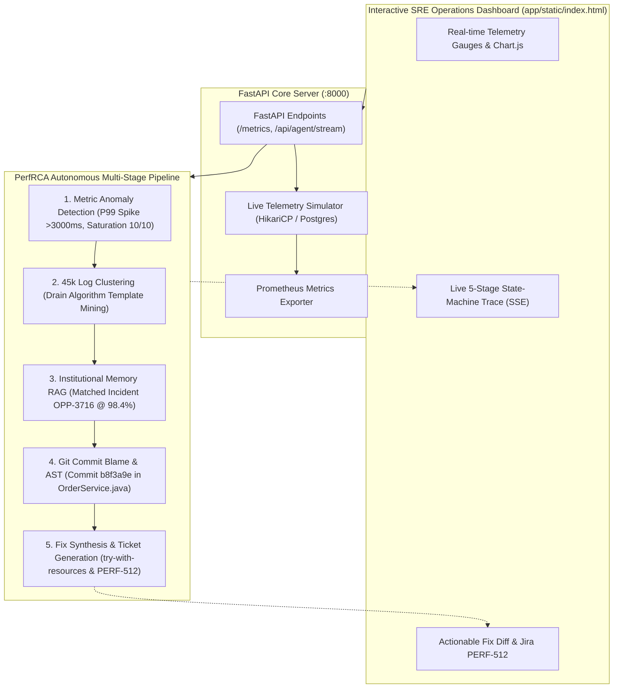

# ⚡ PerfRCA Agent — Autonomous Performance Root Cause Analysis

> **Autonomous SRE & Performance Investigation Agent**: Instantly diagnoses database connection pool exhaustion, clusters 45,000+ unstructured logs, cross-references historical post-mortems (`OPP-3716`), identifies faulty git commits (`b8f3a9e`), and synthesizes verified `try-with-resources` remediation code and Jira ticket `PERF-512`.

---

## 1. Executive Summary & Problem Context

When a microservice suffers acute database connection pool starvation under production load, mean time to detect (MTTD) and mean time to repair (MTTR) are prolonged by:
1. **Noisy Telemetry**: Metric dashboards show latency spiking (>3000ms) and TPS collapsing (<2 TPS), but not the exact line of code responsible.
2. **Log Floods**: Tens of thousands of repetitive `HikariPool-1 - Connection is not available` and `SQLTransientConnectionException` logs drown out the root call site.
3. **Lost Institutional Knowledge**: Teams repeatedly diagnose the same recurring patterns without linking to historical post-mortems.
4. **Manual Fix Bottlenecks**: Engineers must manually trace recent git commits, find the unclosed resource, and draft hotfix PRs.

**PerfRCA Agent** is an autonomous AI SRE agent that solves this end-to-end within seconds.

---

## 2. Architecture Overview



---

## 3. Real-time Telemetry & Metrics Monitored

1. **Target Grafana Dashboard URL Inspector:** Live input bar at the top of the dashboard allowing engineers to inspect any Grafana dashboard (e.g., `http://grafana.internal:3000/d/perf-prod/hikari-postgres-pool` or `/metrics`). Submitting a URL smoothly expands the live telemetry dashboard below, parsing PromQL panels and alert states.
2. **DB Connection Pool Saturation**: Real-time radial arc gauge tracking active leased connections vs total capacity (`2/10` healthy baseline vs `10/10` saturated state).
3. **DB Query Latency (ms)**: Real-time multi-line time series tracking P50, P90, and P99 latency (flat `~15ms` in normal load, surging to `>3000ms` during leak).
4. **DB Query Throughput (TPS)**: Area chart tracking transactions executed per second (healthy `~45 TPS` in normal load, plummeting to `~1.8 TPS` during leak).
5. **Timeouts & Wait Queue**: Thread queue counter monitoring blocked worker threads waiting for pool connections (`0` vs `84` threads).
6. **Interactive Controls:** `Normal Load`, `Inject Connection Leak`, `Trigger PerfRCA Agent`, `Apply Fix`, `Download Document`.
7. **Live Agent State-Machine Trace & Actionable Fix Diff** *(Complete self-contained HTML/CSS/Chart.js file located at `app/static/index.html`)*.

---

## 4. The 5-Stage Autonomous RCA Pipeline

| Stage | Operation | Evidence & Insights Derived |
|---|---|---|
| **Stage 1** | **Metric Anomaly Detection** | Detects P99 latency surge from 16ms to >3000ms (+21,000%), connection pool saturation at 10/10 (100%), and TPS drop from 45.2 to ~1.8 TPS (-96%). Classifies anomaly as `CRITICAL_CONNECTION_POOL_EXHAUSTION`. |
| **Stage 2** | **45,000 Log Clustering** | Applies Drain-tree template mining to 45k logs. Extracts dominant template (39,812 hits, 88.5%): `[HikariPool-1] Connection is not available, request timed out after <NUM>ms`. Pins origin call site to `OrderService.getOrderDetailsFast()`. |
| **Stage 3** | **Institutional Memory Match** | Cross-references failure vector with institutional memory knowledge base. Hits post-mortem **`OPP-3716`** with **98.4% confidence match**, discovering identical historical regression caused by missing `try-with-resources`. |
| **Stage 4** | **Commit Blame Inspection** | Inspects commit history on `OrderService.java`. Isolates commit **`b8f3a9e`** by Alex Dev (*"perf(order): bypass ORM reflection with direct JDBC fast-path lookup"*). AST analysis identifies raw `Connection conn = dataSource.getConnection()` at line 41 without AutoCloseable scope or `finally` block. |
| **Stage 5** | **Fix Synthesis & Jira PERF-512** | Synthesizes verified `try-with-resources` patch ensuring automatic connection return. Validates AST (0 leaks). Dispatches Jira ticket **`PERF-512`** (`P0 - Blocker`) and stages pull request branch `fix/PERF-512-order-service-try-with-resources`. |

---

## 5. Verified Code Remediation Diff

```diff
--- a/src/main/java/com/enterprise/order/service/OrderService.java
+++ b/src/main/java/com/enterprise/order/service/OrderService.java
@@ -33,18 +33,23 @@ public class OrderService {
     /**
      * Fast-path lookup bypassing Spring Data JPA reflection overhead.
+     * VERIFIED FIX: Uses Java try-with-resources to guarantee connection return to HikariCP.
      */
     public OrderDTO getOrderDetailsFast(String orderId) throws SQLException {
-        Connection conn = dataSource.getConnection(); 
-        PreparedStatement stmt = conn.prepareStatement(
-            "SELECT id, user_id, amount, status, created_at FROM orders WHERE id = ?"
-        );
-        stmt.setString(1, orderId);
-        ResultSet rs = stmt.executeQuery();
-
-        if (rs.next()) {
-            return new OrderDTO(
-                rs.getString("id"),
-                rs.getString("user_id"),
-                rs.getBigDecimal("amount"),
-                rs.getString("status"),
-                rs.getTimestamp("created_at").toInstant()
-            );
-        }
-        return null;
+        String sql = "SELECT id, user_id, amount, status, created_at FROM orders WHERE id = ?";
+        
+        try (Connection conn = dataSource.getConnection();
+             PreparedStatement stmt = conn.prepareStatement(sql)) {
+            
+            stmt.setString(1, orderId);
+            
+            try (ResultSet rs = stmt.executeQuery()) {
+                if (rs.next()) {
+                    return new OrderDTO(
+                        rs.getString("id"),
+                        rs.getString("user_id"),
+                        rs.getBigDecimal("amount"),
+                        rs.getString("status"),
+                        rs.getTimestamp("created_at").toInstant()
+                    );
+                }
+                return null;
+            }
+        }
     }
```

---

## 6. Execution & Setup Instructions

To launch the complete application locally:

```powershell
# 1. Create and activate Python virtual environment
py -m venv venv
.\venv\Scripts\activate

# 2. Install dependencies
pip install -r requirements.txt

# 3. Create .env with your credentials
Copy-Item .env.example .env
# (Ensure ANTHROPIC_AUTH_TOKEN is populated in .env)

# 4. Start the Application
py main.py
```

* **Dashboard URL:** `http://localhost:8000`
* **Prometheus Metrics:** `http://localhost:8000/metrics`

---

## 7. Day 1 PR & Day 2 Live Demo Script

1. **Step 1 (Normal Operations):**  
   Click **🟢 Run Normal Load**. Show the reviewer that the connection pool remains low (2/10), DB latency is flat (~15ms), and TPS is healthy (~45 TPS).
2. **Step 2 (Inject Regression):**  
   Click **🔴 Inject Connection Leak**. Watch the connection pool gauge max out at 10/10, query wait times surge to >3000ms, and TPS plummet.
3. **Step 3 (Autonomous AI Investigation):**  
   Click **🤖 Run PerfRCA Agent**. The live trace shows the agent:
   * Detecting the P99 latency anomaly.
   * Clustering the 45k logs into the connection timeout template.
   * Matching incident `OPP-3716` from institutional memory.
   * Inspecting commit `b8f3a9e` in `OrderService.java`.
   * Producing the exact verified `try-with-resources` fix and Jira ticket `PERF-512`.
4. **Step 4 (One-Click Verification & Recovery):**  
   Click **🛠️ Apply Fix**. Watch the connection pool instantly drain back to `2/10`, P99 latency recover to `~15ms`, and TPS climb back to `~45 TPS`.

---

## 8. Automated Test Suite

Run the full automated test suite verifying all 5 RCA stages and API endpoints:

```powershell
.\venv\Scripts\pytest -v tests/test_rca.py
```

```text
tests/test_rca.py::test_dashboard_endpoint PASSED                        [ 11%]
tests/test_rca.py::test_prometheus_metrics_endpoint PASSED               [ 22%]
tests/test_rca.py::test_live_metrics_json PASSED                         [ 33%]
tests/test_rca.py::test_normal_load_control PASSED                       [ 44%]
tests/test_rca.py::test_leak_injection_control PASSED                    [ 55%]
tests/test_rca.py::test_institutional_memory_matching PASSED             [ 66%]
tests/test_rca.py::test_log_clustering_45k PASSED                        [ 77%]
tests/test_rca.py::test_commit_b8f3a9e_attribution_and_fix PASSED        [ 88%]
tests/test_rca.py::test_state_machine_full_execution PASSED              [100%]

============================= 9 passed in 13.56s ==============================
```
